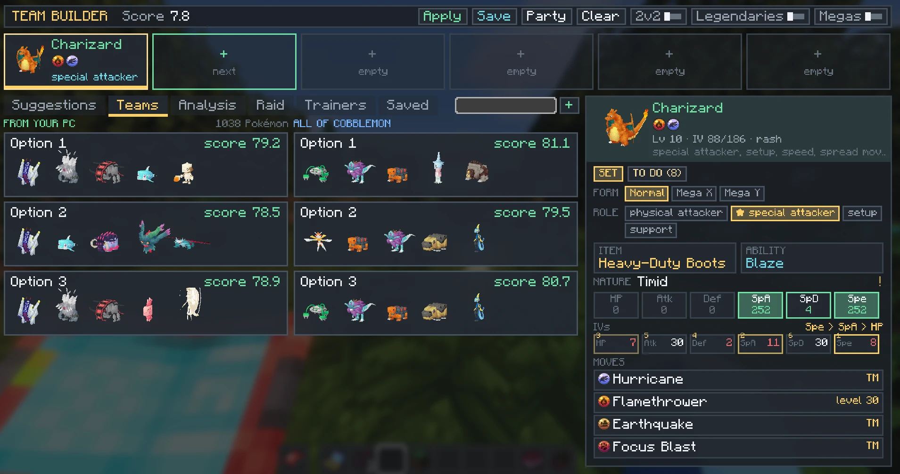
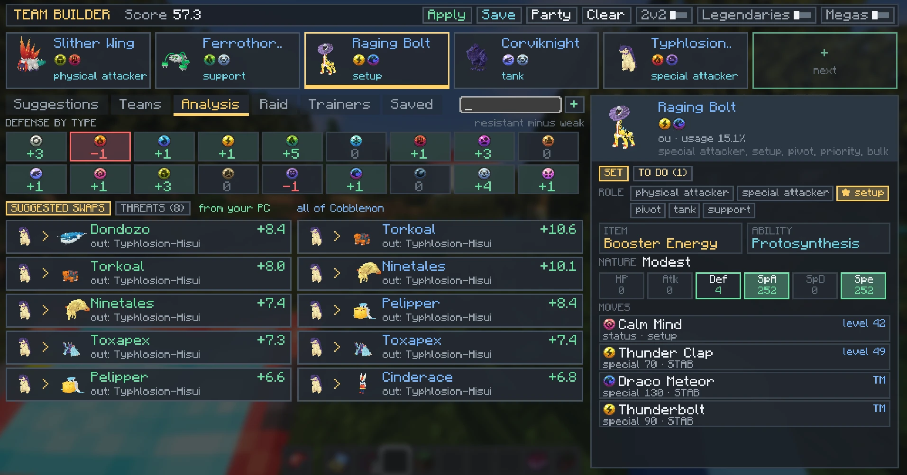
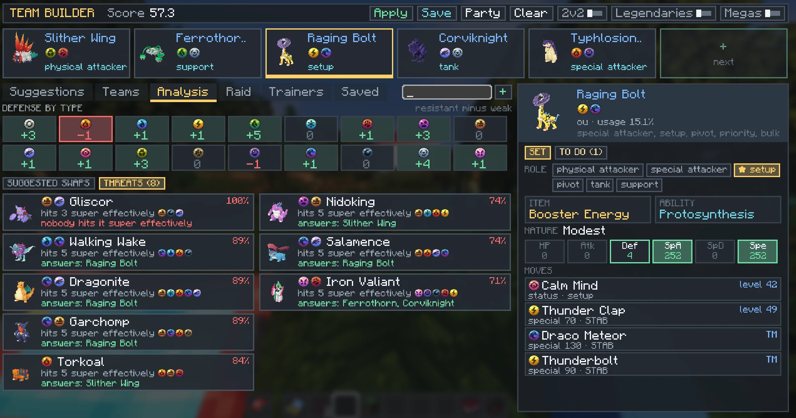
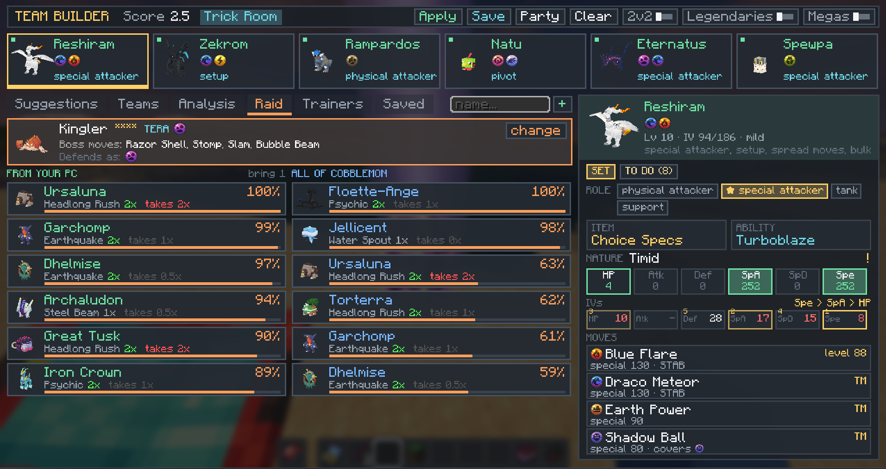
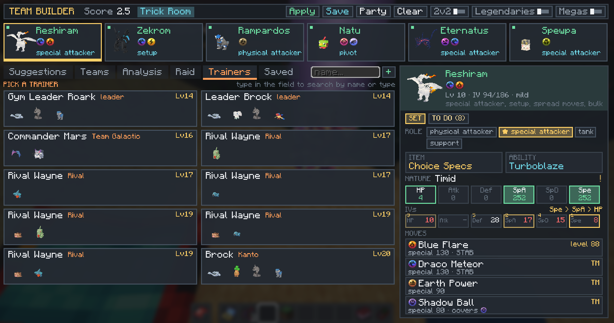
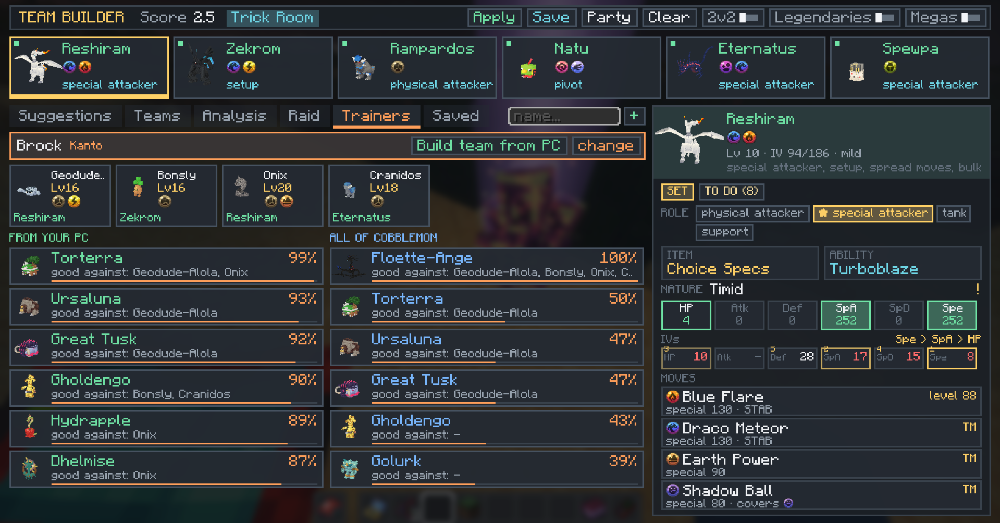
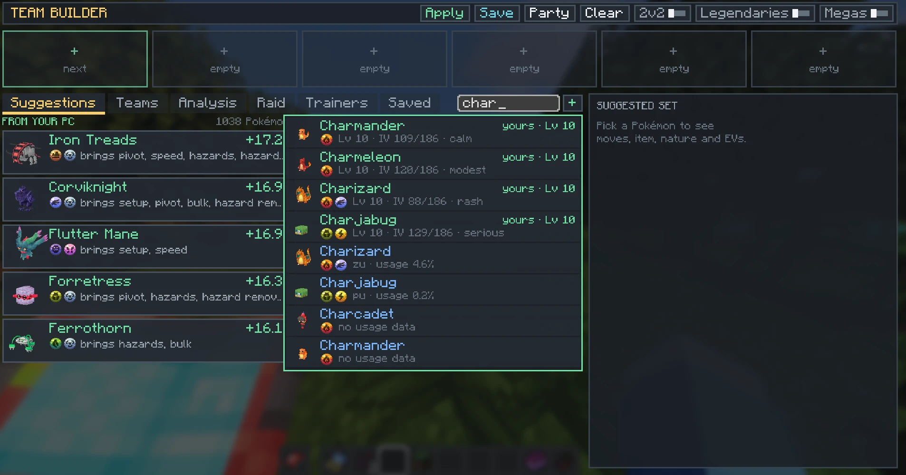

# Cobblemon Team Builder

**Monte times competitivos com os Pokémon que você já tem.**

O Cobblemon Team Builder é um mod Fabric para Minecraft 1.21.1 + Cobblemon 1.7. Ele lê o seu party e o seu PC, compara com as estatísticas de uso reais do Smogon e mostra o que vale a pena:
- quem colocar no próximo slot;
- que função cada membro cumpre;
- quais golpes, item, natureza e EVs usar;
- o que ainda falta para deixar o seu Pokémon pronto.

Funciona para batalhas **1v1 (singles)** e **2v2 (duplas)**, contra **raids** e contra os **líderes, Elite 4 e campeões** do Radical Cobblemon Trainers.

No jogo, aperte **H** para abrir.

**[⬇ Baixar a versão mais recente](https://github.com/thalbl/cobblemon-team-builder/releases/latest)**



---

## Sumário

- [Por que usar](#por-que-usar)
- [Instalação](#instalação)
- [Tour pela tela](#tour-pela-tela)
  - [Tutorial](#tutorial)
  - [Conquistas](#conquistas)
- [Recursos em detalhe](#recursos-em-detalhe)
- [Comandos](#comandos)
- [Configuração](#configuração)
- [Dados do Smogon](#dados-do-smogon)
- [Como a nota do time é calculada](#como-a-nota-do-time-é-calculada)
- [Para desenvolvedores](#para-desenvolvedores)
- [Licença](#licença)

---

## Por que usar

- **Usa o que você tem.** Cada sugestão vem em duas colunas: *do seu PC* e *todo o Cobblemon*. Assim você vê o melhor que dá para montar agora e o que vale a pena ir capturar.
- **Explica cada escolha.** Toda sugestão diz o motivo: quais tipos ela segura, em quais tipos bate, que função traz, com quem forma dupla comum no meta.
- **Pensa no time, não no Pokémon sozinho.** A função de cada membro muda o que os outros precisam cobrir. Se alguém já põe Stealth Rock, ninguém mais precisa.
- **Leva até o fim.** O checklist mostra golpe a golpe, mint, item e EVs o que ainda falta, e confere o que você já tem no inventário.
- **Em português e inglês**, conforme o idioma do jogo.

---

## Instalação

1. Baixe o `cobblemon-team-builder-<versão>.jar` na [página de releases](https://github.com/thalbl/cobblemon-team-builder/releases) (ou na pasta [`dist/`](dist/)).
2. Coloque o jar na pasta `mods` da sua instância.
3. Abra o jogo e aperte **H**.

> **Joga o COBBLEVERSE?** Ele já traz todas as dependências, então basta o passo 2.

### Dependências

**Obrigatórias** (o jogo não abre sem elas):

| Mod | Versão mínima | Testado com |
|---|---|---|
| Minecraft | 1.21.1 | 1.21.1 |
| Java | 21 | 21 |
| [Fabric Loader](https://fabricmc.net/use/) | 0.17.2 | 0.17.2 |
| [Fabric API](https://modrinth.com/mod/fabric-api) | 0.116.6+1.21.1 | 0.116.14+1.21.1 |
| [Fabric Language Kotlin](https://modrinth.com/mod/fabric-language-kotlin) | 1.13.6+kotlin.2.2.20 | 1.13.13+kotlin.2.4.10 |
| [Cobblemon](https://modrinth.com/mod/cobblemon) | 1.7.3 | 1.7.3+1.21.1 |

**Opcionais** (cada uma liga um recurso; sem elas o resto funciona normalmente):

| Mod | O que libera | Testado com |
|---|---|---|
| [Cobblemon Raid Dens](https://modrinth.com/mod/cobblemonraiddens) | detecta sozinho o chefe da raid mais próxima (sem ele, você digita o chefe) | 0.11.3+1.21.1 |
| [Radical Cobblemon Trainers](https://modrinth.com/mod/rctmod) | aba **Treinadores** (times de líderes, Elite 4, campeões, equipes vilãs...) | 0.18.1-beta |
| [Cobblemon: Mega Showdown](https://modrinth.com/mod/cobblemon-mega-showdown) | formas **mega** para sugerir e alternar (o Cobblemon não tem megas sozinho) | 1.8.4+1.7.3+1.21.1 |

### Em servidor

O mod precisa estar **no servidor e em cada jogador**. O servidor faz todo o cálculo (lê o PC e o party, os dados do Smogon e os treinadores) e o cliente só desenha a tela.

| Situação | O que acontece |
|---|---|
| Servidor e jogador com o mod | tudo funciona |
| Servidor com o mod, jogador sem | o jogador entra normalmente; não tem a tela, mas os comandos `/teambuilder` funcionam pelo chat |
| Jogador com o mod, servidor sem | a tela abre e avisa que o servidor não tem o Team Builder |
| Mundo single-player | funciona direto |

As opções (lendários, megas, 2v2) e as funções escolhidas são separadas por jogador. Os times salvos ficam no computador de cada um.

---

## Tour pela tela

A tela tem quatro partes, de cima para baixo e da esquerda para a direita:

- **Cabeçalho:** a nota do time (passe o mouse para ver de onde ela vem), os núcleos ativos e os botões.
- **Slots:** clique para ver o set no painel da direita e no **x** para remover. Cada slot mostra a função escolhida, um ponto verde se o Pokémon está no seu party e um **M** se está na forma mega.
- **Abas:** cada uma é explicada abaixo.
- **Campo de nome:** busca Pokémon enquanto você digita. Na aba Treinadores, busca treinadores.
- **Painel da direita:** o set do slot selecionado, ou o checklist do que falta.

Passe o mouse em quase tudo: os tooltips trazem os detalhes, com os tipos coloridos. Em cima dos **ícones de tipo** de qualquer Pokémon aparece a tabela de defesa dele: o que leva 4x, 2x, o que resiste (½x, ¼x) e onde é imune, já considerando habilidades como Levitate ou Flash Fire.

### Tutorial

Na primeira vez que a tela abre, um tour passo a passo destaca uma parte da tela por vez (slots, nota, botões, abas, busca e painel do set), com um balão curto explicando cada uma. Na primeira visita a cada aba aparece uma dica de 1 ou 2 passos só daquela aba. Enter ou as setas avançam e Esc pula. O botão **?** no canto (ou **F1**) reabre o tour quando quiser. O que já foi visto fica salvo em `config/cobblemon_team_builder/client.json`.

### Conquistas

São 20 conquistas que ensinam o mod aos poucos, do primeiro Pokémon até vencer a Elite 4. O botão **★ n/20** no canto mostra a lista em três grupos (Montagem, Preparação e Batalhas), com o próximo passo de cada ramo destacado. Elas também aparecem como **Progressos** do Minecraft (tecla L), com notificação, e ficam salvas no mundo.

As de batalha conferem se você seguiu a recomendação. O mod lembra quem recomendou contra cada chefe de raid e cada treinador (em `world/data/cobblemon_team_builder_memory.json`):
- **raid:** vencer levando pelo menos um Pokémon recomendado contra aquele chefe. Precisa do Cobblemon Raid Dens.
- **treinador, ginásio, Elite 4 e campeão:** vencer com 3 ou mais dos Pokémon recomendados contra aquele treinador. Precisa do Radical Cobblemon Trainers.

---

## Recursos em detalhe

### Sugestões
As 5 melhores opções para o próximo slot, em duas colunas: **do seu PC** e **todo o Cobblemon**. Cada card mostra quanto a nota do time sobe e por quê:
- "segura [tipos]": cobre fraquezas do time;
- "bate em [tipos]": traz cobertura nova;
- "traz [funções]": hazards, pivô, velocidade, prioridade...;
- dupla comum no meta com alguém do time;
- se o Pokémon ativa ou aproveita um núcleo (chuva, Trick Room...);
- um alerta quando ele acumula uma fraqueza que o time já tem.

Os tipos aparecem como ícones.

### Times
Cinco formas diferentes de completar o time a partir dos slots preenchidos, também do seu PC e de todo o Cobblemon. Clique para usar. Se a tela for baixa, role a coluna com a rodinha do mouse.

### Análise
- **Defesa por tipo:** para cada um dos 18 tipos, o saldo de resistentes menos fracos, com marcas de quantos membros são **imunes (0x)** e quantos levam **4x**. Os tipos perigosos piscam em vermelho. No hover aparece o multiplicador de cada membro, do que leva mais dano para o que leva menos.
- **Trocas:** a troca de um membro que mais aumenta a nota.
- **Ameaças:** os Pokémon fortes do meta que o seu time segura mal. Mostra quantos membros ele acerta em cheio (e com quais tipos), quem resiste e quem responde. Quando ninguém consegue bater nele com vantagem, aparece um alerta.
- **Duplas** (só no 2v2): o time dividido nas 3 melhores duplas, com a sugestão de abertura. Veja [Duplas do 2v2](#duplas-do-2v2).

| Trocas sugeridas | Ameaças |
|---|---|
|  |  |

### Raid
Com o Cobblemon Raid Dens, a aba detecta o chefe da raid em que você está, ou do cristal mais próximo (até 8 blocos), já com o tipo tera. Também dá para digitar o chefe, por exemplo `charizard fire`. Lista os melhores counters com:
- o melhor golpe contra o chefe e o multiplicador;
- o pior golpe do chefe neles;
- se o golpe precisa ser aprendido antes.



### Treinadores
Lê os times reais do Radical Cobblemon Trainers: cerca de 1.700 treinadores, incluindo os ginásios, a Elite 4 e os campeões do COBBLEVERSE. Escolha um (ou busque pelo nome ou tipo) para ver:
- o time dele, com nível, golpes, item, habilidade e natureza no tooltip;
- quem do seu time responde melhor a cada Pokémon dele;
- os melhores counters do seu PC e de todo o Cobblemon, e contra quem cada um é bom;
- o botão **Montar time do PC**, que coloca os 6 melhores counters que você tem nos slots.

| Escolher o treinador | Counters contra o Brock |
|---|---|
|  |  |

### Salvos
Guarda times para consultar depois, com as funções escolhidas. O texto do campo de nome vira o nome do time. Ficam em `config/cobblemon_team_builder/saved_teams.json` e valem para qualquer mundo ou servidor.

### Funções por membro
Cada Pokémon pode ter uma ou mais funções, conforme o que aprende e os seus stats: **atacante físico**, **atacante especial**, **setup**, **pivô**, **tanque** ou **suporte**.
- A **recomendada** vem marcada com ★. Ela considera os stats, o set mais usado no Smogon e o que o resto do time já faz.
- Passe o mouse numa função para ver a natureza, os EVs, o item e os golpes que ela daria.
- A função escolhida muda o set **dele e dos companheiros**: quem já tem hazards ou remoção libera os outros, e duas funções iguais rendem menos que funções variadas.

### Set sugerido
Para o slot selecionado, o painel mostra:
- **item** (com uma alternativa) e **habilidade**;
- **natureza e EVs**, com um aviso quando o seu exemplar difere;
- **IVs** atuais com a **prioridade para subir** (1, 2, 3); os atributos que o set não usa aparecem com "-";
- **golpes**, cada um com o tipo, a categoria, o poder e o motivo (STAB, "cobre [tipos]", "o time não tem hazards"...). Também diz se você **já tem** o golpe, se ele está **no menu** (já aprendido) ou **como aprender** (nível, TM, tutor, egg move...).

O set parte do mais usado no Smogon, só com golpes que o Pokémon aprende no Cobblemon. Quando a espécie não tem dados de uso, uma heurística monta o set.

### Checklist ("Falta")
A segunda aba do painel lista o que falta para o **seu** Pokémon ficar igual ao set:
- golpes que ainda precisa aprender;
- **mint** da natureza;
- **Ability Capsule / Patch**;
- **item** segurado, ou a **mega stone**;
- **EVs** atuais contra a meta, e se você tem a vitamina;
- **IVs** a subir.

O checklist confere o seu inventário. ✔ quer dizer pronto, ● quer dizer que você já tem o item necessário e ✘ quer dizer que falta conseguir.

### Formas mega
Se o Pokémon tem mega, aparecem botões **Normal / Mega X / Mega Y**. Como só cabe uma mega por batalha, escolher uma mega volta outra mega do time para a forma normal. A função escolhida acompanha o Pokémon na troca.

### Núcleos de time
O mod detecta quando o time ativa **chuva, sol, areia, neve, os quatro terrenos ou Trick Room**, por habilidade ou golpe, e passa a valorizar quem aproveita:
- clima e terreno: Swift Swim, Chlorophyll, Sand Rush, Surge Surfer, Protosynthesis, Thunder na chuva...;
- Trick Room: os Pokémon lentos e fortes recebem sets lentos (Brave/Quiet, 0 EV de velocidade) e o aviso de que o ideal é IV de Spe 0.

Os núcleos ativos aparecem no cabeçalho; passe o mouse para ver quem ativa e quem aproveita.

### 1v1 e 2v2
O interruptor **2v2** troca o modo para duplas:
- a nota passa a valorizar **controle de velocidade** (Tailwind, Trick Room, Icy Wind...), **Fake Out**, **Protect**, **redirecionamento**, **Intimidate** e **golpes em área**;
- hazards quase não contam;
- os sets e as sugestões usam estatísticas de uso de duplas (Doubles OU, VGC...).

### Duplas do 2v2
No 2v2, a Análise ganha o botão **Duplas**. O mod dá uma nota para cada par do time, testa todas as formas de dividir o time em 3 duplas e fica com a de maior soma. A dupla que melhor controla o primeiro turno (Fake Out, Tailwind ou Trick Room, Intimidate, clima) é a sugestão de **abertura**; as outras ficam no banco.

A nota de cada dupla considera:
- **defesa:** um segura o que o outro não aguenta; os dois fracos ao mesmo tipo perdem pontos;
- **ataque:** juntos acertam com vantagem tipos que nenhum acerta sozinho;
- **golpes que acertam o parceiro** (Earthquake, Surf, Discharge): bônus se o parceiro é imune (Voador, Levitate, Telepathy...), penalidade se ele leva o dano;
- **suporte e atacante:** puxar ataques, Fake Out ou Helping Hand ao lado de quem tem setup ou bate muito forte;
- **núcleos:** quem ativa clima, terreno ou Trick Room ao lado de quem aproveita;
- **velocidade:** Trick Room com parceiro lento, Tailwind com parceiro de velocidade média;
- **meta:** duplas que aparecem juntas no Smogon mais do que o esperado.

Os cartões mostram as duplas com a nota e o principal motivo; o hover lista todos os prós e contras. Ao lado, uma grade mostra a nota de todos os pares possíveis. Nos slots, uma faixa colorida com a letra indica a dupla de cada membro (A = abertura), e o painel do set diz com quem ele faz dupla. As notas usam os golpes do set sugerido, então mudam quando você troca a função de alguém.

### Busca
Enquanto você digita, aparecem cards com modelo, tipos e nível, com os **seus** Pokémon primeiro. Enter escolhe o primeiro card e Esc fecha a lista. Para adicionar vários de uma vez, separe por vírgula: `rillaboom, great tusk`.



### Aplicar ao party
O botão **Aplicar** coloca no seu party os Pokémon do time que você tem, na ordem dos slots. Quem sai do party vai para o PC. Os Pokémon que você não tem são ignorados, e o botão não funciona durante uma batalha.

### Opções
- **Lendários:** permite sugerir lendários, míticos e Pokémon de tier Ubers (desligado por padrão).
- **Megas:** permite sugerir megas, no máximo uma por time.

---

## Comandos

Tudo da tela também existe por chat:

| Comando | O que faz |
|---|---|
| `/teambuilder pc` | lista o que o mod enxerga no seu party e PC |
| `/teambuilder meta <pokemon>` | dados competitivos do Smogon (golpes, itens, spreads, parceiros, counters) |
| `/teambuilder suggest <pokemon...>` | melhores opções para o próximo slot |
| `/teambuilder complete <pokemon...>` | 5 formas de completar o time |
| `/teambuilder analyze` | nota do party atual, fraquezas e trocas do PC |
| `/teambuilder sets [pokemon...]` | set sugerido de cada membro (do party, se não informar nomes) |
| `/teambuilder raid [chefe [tipo tera]]` | counters contra o chefe da raid |
| `/teambuilder option legendaries\|megas\|doubles true\|false` | muda as suas opções |

Comandos de **admin** (exigem permissão, que é configurável):

| Comando | O que faz |
|---|---|
| `/teambuilder reload` | relê a configuração e os dados |
| `/teambuilder snapshot` | mostra os dados do Smogon em uso |
| `/teambuilder snapshot update [mês] [doubles]` | baixa dados novos do Smogon, em segundo plano (ex.: `2026-11`) |
| `/teambuilder snapshot reset` | volta aos dados que vêm no jar |

---

## Configuração

O arquivo `config/cobblemon_team_builder/config.json` é criado na primeira execução. Depois de editar, use `/teambuilder reload`.

| Campo | Padrão | O que faz |
|---|---|---|
| `defaultLegendaries` | `false` | opção inicial de lendários para cada jogador |
| `defaultMegas` | `true` | opção inicial de megas |
| `defaultDoubles` | `false` | começar no modo 2v2 |
| `searchResults` | `8` | quantos cards a busca mostra |
| `threats` | `8` | quantas ameaças a análise lista |
| `adminPermissionLevel` | `2` | permissão dos comandos de admin |
| `weightsSingles` / `weightsDoubles` | — | todos os pesos da nota, separados para 1v1 e 2v2 |

A tecla de abrir (H) muda em **Opções › Controles**.

---

## Dados do Smogon

Os sets, a força de cada Pokémon e as duplas comuns vêm das estatísticas de uso públicas do [Smogon](https://www.smogon.com/stats/) (rating 1500+):
- **singles:** National Dex, OU, Ubers, UU, RU, NU, PU e ZU;
- **duplas:** Doubles OU, Ubers, UU, National Dex Doubles e VGC.

Para cada Pokémon, o mod usa o formato em que ele é mais usado.

O jar já vem com um snapshot desses dados. Para atualizar, use `/teambuilder snapshot update` no jogo (os arquivos vão para `config/cobblemon_team_builder/meta/`) ou o script de [desenvolvimento](#para-desenvolvedores).

---

## Como a nota do time é calculada

A nota soma seis partes (passe o mouse sobre ela no jogo):

| Parte | O que mede |
|---|---|
| **Força** | quão forte cada membro é no meta (tier e uso no Smogon, ou stats quando não há dados) e a qualidade dos IVs do seu exemplar |
| **Defesa** | penaliza tipos de ataque em que o time tem mais fracos que resistentes, e premia ter resposta para cada tipo |
| **Ataque** | quantos tipos o time acerta com vantagem |
| **Funções** | hazards, remoção, pivôs, prioridade, setup, velocidade, resistência e equilíbrio físico/especial (em 2v2: controle de velocidade, Fake Out, redirecionamento, Intimidate, golpes em área) |
| **Sinergia** | duplas que aparecem juntas no meta mais do que o esperado |
| **Núcleo** | membros que aproveitam o clima, o terreno ou o Trick Room ativo |

Sugestões, times completos e trocas são todas formas de comparar essa mesma nota. Os pesos de cada parte ficam na configuração.

---

## Para desenvolvedores

### Compilar

Precisa de um JDK 21 ou mais novo:

```
./gradlew build
```

O jar sai em `build/libs/`; os testes rodam junto.

### Atualizar o snapshot embutido

```
python tools/build_snapshot.py            # singles
python tools/build_snapshot.py --doubles  # duplas (2v2)
```

### Estrutura

| Pasta | Conteúdo |
|---|---|
| `core/` | o "cérebro", em Kotlin puro e sem Minecraft: nota, motor de sugestões, sets e funções, ameaças, núcleos, duplas do 2v2, raids e treinadores, traduções, leitor do Smogon. É coberto pelos testes. |
| `cobblemon/` | a ponte com o Cobblemon: leitura do party e do PC, catálogo de espécies e golpes, raids (Raid Dens), treinadores (RCT), aplicar o time |
| `client/` | a tela, os modelos 3D e os times salvos |
| `net/` | pacotes entre servidor e cliente |
| `command/` | os comandos `/teambuilder` |
| `assets/.../lang/` | traduções em `pt_br.json` e `en_us.json` |

---

## Licença

[MIT](LICENSE)
